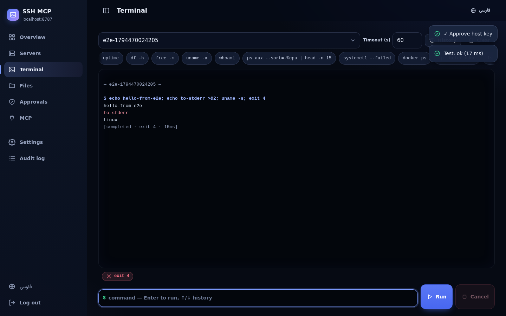

# SSH MCP Server — let Claude, Cursor and other AI assistants manage your Linux server (VPS)

**Free, open-source SSH MCP server with a web dashboard. Runs on Cloudflare Workers. One-click install, no server software needed.**

Talk to your server in plain language: *"How much disk space is left?"*, *"Restart nginx"*, *"Show me the last Docker logs"*.
Your AI assistant does it over SSH, and anything risky waits for **your** approval first.

---

## What you get

- 🤖 **AI server management** — connect Claude, Claude Code, Cursor or any MCP client to your VPS.
- 🖥️ **Web SSH dashboard** — run commands in a browser terminal, from your laptop or your phone.
- 📁 **File manager (SFTP)** — browse, upload, download and edit files on your server.
- 📊 **Server monitoring** — CPU, memory, disk, uptime, processes, services and Docker containers.
- 🛡️ **Safe by default** — dangerous commands (like deleting files or rebooting) need your OK. Every action is logged.
- 🔒 **Private** — runs in **your own** Cloudflare account. Passwords and keys are encrypted. Nothing to install on the server.
- 🆓 **Free and open source** — start on Cloudflare's free plan; the $5/month Workers paid plan gives more room for heavy use.
- 🌍 English and Persian (فارسی) interface, dark mode, mobile friendly.

## Install in 3 steps

1. **Click the "Deploy to Cloudflare" button** above and sign in (a free Cloudflare account is fine).
2. **Fill in three passwords** when asked. Just type any long phrases you like — for example a few random words:
   - `ENCRYPTION_KEY` — at least 32 characters. Save it somewhere safe.
   - `SESSION_SECRET` — a different phrase, at least 32 characters.
   - `SETUP_TOKEN` — at least 12 characters. You'll use it once in the next step.
3. **Open your new link** (it looks like `https://cf-ssh-mcp.yourname.workers.dev`), enter your `SETUP_TOKEN`
   and choose your admin password. Done!

> Prefer GitHub Actions or the command line? See the [technical guide](docs/TECHNICAL.md#install).

## Add your server

In the dashboard go to **Servers → Add server**, enter your server's address, username and password (or SSH key),
then press **Connect** and **Approve** the server's fingerprint. That's it — you can now use the terminal and file manager.

## Connect your AI assistant

1. In the dashboard open **MCP** and press **Create token**. Copy it (it's shown only once).
2. Add a connector in your AI app with this address and header:
   - URL: `https://<your-link>/mcp`
   - Header: `Authorization: Bearer <your token>`

The dashboard shows step-by-step instructions for **Claude**, **Claude Desktop**, **Claude Code** and **Cursor**.

Now just ask: *"Check if my website's server is healthy"* or *"Which Docker containers are running?"*

## What can the AI do?

25 tools, including: run commands, read and write files, upload and download, check CPU / memory / disk usage,
list processes, check services (systemd), and list, inspect and read logs of Docker containers.
It can work with several servers — just say which one.

## Is it safe?

- Read-only commands run right away. Commands that change or delete things wait for your approval in the dashboard
  (you can relax this per server if you want).
- Server passwords and keys are encrypted and never shown again.
- The server's identity (host key) is checked every time, so you can't be tricked into connecting to a fake server.
- Your dashboard is protected by your admin password; the AI uses a separate token you can revoke at any time.

Found a security problem? Please see [SECURITY.md](SECURITY.md).

## Good to know

- Works with normal Linux servers that allow SSH (Ubuntu, Debian, CentOS, and so on).
- It runs commands one by one — interactive programs (like `top` or `vim`) and port forwarding are not supported.
- SSH keys protected with a passphrase need Cloudflare's paid plan (they need more CPU time).

## FAQ

**Do I need to install anything on my server?** No. It uses the normal SSH that your server already has.

**Does it cost money?** The project is free. You can start on Cloudflare's free plan; if you hit its limits (each request gets very little CPU time), the Workers paid plan costs $5/month.

**Which AI apps work?** Any app that supports MCP (Model Context Protocol) remote servers, such as Claude, Claude Code and Cursor.

**Can I use it without AI?** Yes. The dashboard alone is a complete web SSH client and file manager.

---

## فارسی

**مدیریت سرور لینوکس (VPS) با هوش مصنوعی** — یک سرور MCP رایگان و متن‌باز با داشبورد وب که روی کلادفلر اجرا می‌شود.
با Claude یا Cursor به زبان ساده به سرورت بگو چه کار کند؛ کارهای خطرناک اول منتظر تأیید خودت می‌مانند.

**نصب در ۳ قدم:**
۱. روی دکمهٔ «Deploy to Cloudflare» بالای صفحه بزن و وارد حساب کلادفلر شو.
۲. سه رمز بخواسته‌شده را با چند کلمهٔ دلخواه پر کن (دوتای اول حداقل ۳۲ حرف، سومی حداقل ۱۲ حرف).
۳. لینک ساخته‌شده را باز کن، رمز سوم را وارد کن و رمز مدیر را انتخاب کن.

بعد از آن، در بخش «سرورها» سرورت را اضافه کن و در بخش MCP یک توکن بساز تا دستیار هوش مصنوعی‌ات وصل شود.
زبان داشبورد را می‌توانی از منو روی فارسی بگذاری.

---

Keywords: SSH MCP server, MCP SSH, Claude SSH, Claude VPS, Cursor SSH, AI server management, AI DevOps assistant,
manage Linux server with AI, web SSH client, browser SSH terminal, SFTP file manager, Cloudflare Workers SSH, Model Context Protocol, remote server management.

MIT License · [Technical guide](docs/TECHNICAL.md) · [Test report](TEST_REPORT.md)
